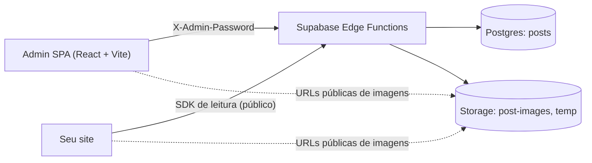

# MDPostComposer

[English](README.md) | Português (Brasil)

O MDPostComposer é um compositor de posts em Markdown, plugável, para sites baseados em Supabase. Ele oferece uma pequena API HTTP (Supabase Edge Functions sobre Postgres e Storage), um painel admin em React para escrever e gerenciar posts, e um SDK de leitura mais um renderizador de Markdown que você pode usar no seu próprio site para exibi-los. Você mantém seu site, seu design e sua hospedagem; o MDPostComposer cuida apenas do fluxo de conteúdo.

- Escreva posts em Markdown com pré-visualização, banner e imagens no corpo.
- Rascunhe imagens em uma área temporária, referencie-as pelo nome (``) e deixe o servidor movê-las para a pasta do post ao salvar.
- Categorias definidas por variáveis de ambiente, posts ativos/inativos (posts inativos são privados), edição e exclusão de posts existentes.
- Interface do admin em inglês e português do Brasil, sem serviço de login: uma única senha de admin mantida apenas em memória.
- SDK de leitura (`@mdpc/shared/client`) e um `MarkdownRenderer` com sanitização (GFM + HTML bruto) para qualquer site React; ou chame a API HTTP pura de qualquer linguagem.
- O admin é uma SPA estática: gere o build uma vez e hospede `admin/dist` onde quiser.

## Arquitetura



- Escritas (`create_post`, `update_post`, `delete_post`, `temp_images`) exigem a senha de admin.
- Leituras (`load_cards`, `load_post`) são públicas para posts ativos; posts inativos exigem a senha.
- Somente as Edge Functions acessam o banco e os buckets (com a service role). As imagens são servidas direto das URLs públicas do Storage.

### Estrutura do repositório

```
admin/       Painel admin React 19 + Vite (SPA estática)
shared/      @mdpc/shared: contratos, regras de domínio, SDK de leitura, MarkdownRenderer (fontes TypeScript, sem etapa de build)
supabase/    config.toml, migração SQL, Edge Functions (Deno) e seus testes
scripts/     smoke test contra um stack em execução
```

## Requisitos

- Node.js 20+ e pnpm 9
- Docker (para o stack local do Supabase)
- Deno 2 (opcional: testes e checagem de tipos das functions)
- Um projeto Supabase (apenas para deploy remoto)

A CLI do Supabase é instalada como dependência de desenvolvimento; execute-a com `pnpm supabase <comando>`.

## Início rápido (local)

```bash
pnpm install

# 1. Suba o stack local do Supabase (Postgres, Storage, gateway da API) e aplique a migração
pnpm supabase start
pnpm supabase db reset

# 2. Configure as functions e o admin
cp supabase/functions/.env.example supabase/functions/.env.local
cp admin/.env.example admin/.env.local
# PowerShell: Copy-Item supabase/functions/.env.example supabase/functions/.env.local
#             Copy-Item admin/.env.example admin/.env.local

# 3. Sirva as Edge Functions (deixe rodando em um terminal próprio)
pnpm supabase functions serve --env-file supabase/functions/.env.local

# 4. Inicie o admin (em outro terminal)
pnpm dev
```

Edite `supabase/functions/.env.local`: defina `MDPC_ADMIN_PASSWORD` com a sua senha e `MDPC_PUBLIC_STORAGE_URL=http://127.0.0.1:54321/storage/v1/object/public` (senão as URLs de imagem retornadas pelas functions apontam para o host interno do Docker e não carregam no navegador). Mantenha `http://localhost:5173` (o servidor de desenvolvimento do Vite) em `MDPC_ALLOWED_ORIGINS`. Os valores padrão de `admin/.env.example` já apontam para o stack local. Se você alterar `MDPC_POST_CATEGORIES`, altere `VITE_MDPC_POST_CATEGORIES` para a mesma lista.

Abra http://localhost:5173 e desbloqueie o admin com a senha. O navegador nunca a armazena: ao recarregar a página ela é pedida novamente.

`supabase db reset` recria o banco local, incluindo os dois buckets padrão (`post-images`, `temp`). Pare o stack com `pnpm supabase stop` (adicione `--no-backup` para descartar os dados).

Teste toda a API com o [smoke test](#smoke-test).

## Deploy (projeto Supabase remoto)

```bash
pnpm supabase login
pnpm supabase link --project-ref <project-ref>
pnpm supabase db push

cp supabase/functions/.env.example supabase/functions/.env.production   # depois edite o arquivo
pnpm supabase secrets set --env-file supabase/functions/.env.production
pnpm supabase functions deploy
```

- `SUPABASE_URL` e `SUPABASE_SERVICE_ROLE_KEY` são injetadas pelo Supabase; não as defina.
- Toda function tem `verify_jwt = false` em `supabase/config.toml`. É intencional: quem chama não é um usuário do Supabase, e a autorização é o header `X-Admin-Password`, verificado dentro das functions (os endpoints públicos de leitura não precisam de credencial). Mantenha essa configuração; com `verify_jwt = true` os navegadores precisariam de um JWT do Supabase.
- Defina `MDPC_ALLOWED_ORIGINS` com as origens exatas do site do admin e de todo site que lê posts pelo navegador (por exemplo `https://admin.example.com,https://www.example.com`). Esquema, host e porta devem coincidir.
- Gere o build do admin com os valores de produção e hospede o resultado em qualquer host estático:

  ```bash
  # admin/.env.production
  # VITE_MDPC_FUNCTIONS_URL=https://<project-ref>.supabase.co/functions/v1
  # VITE_MDPC_STORAGE_PUBLIC_URL=https://<project-ref>.supabase.co/storage/v1/object/public
  pnpm build        # saída: admin/dist
  ```

  O admin é gerado para a raiz (`/`); sirva-o na raiz de um (sub)domínio. Os valores são embutidos no build, então alterá-los exige gerar o build de novo.
- Nunca faça commit de `.env.local` / `.env.production` (estão no gitignore).

## Referência de configuração

### Edge Functions (`supabase/functions/.env.local`, ou secrets do Supabase)

| Variável | Obrigatória | Padrão | Descrição |
| --- | --- | --- | --- |
| `MDPC_ADMIN_PASSWORD` | sim | nenhum | Senha de admin esperada no header `X-Admin-Password`. Se estiver ausente, toda requisição falha com `500 SERVER_MISCONFIGURED`. |
| `MDPC_ALLOWED_ORIGINS` | recomendada | vazio | Origens completas separadas por vírgula (`https://admin.example.com`) autorizadas a chamar as functions pelo navegador. Uma requisição cujo `Origin` não esteja na lista recebe `403 FORBIDDEN_ORIGIN`. Requisições sem header `Origin` (servidores, scripts, curl) são sempre aceitas. Uma entrada inválida é erro de configuração. |
| `MDPC_PUBLIC_STORAGE_URL` | não | vazio | URL pública base do Storage usada nas URLs que as functions retornam (`banner_url` em `load_cards` e `load_post`, `publicUrl` em `temp_images`). Deixe vazio em projeto hospedado. Para `supabase functions serve` local, defina como `http://127.0.0.1:54321/storage/v1/object/public`, pois ali `SUPABASE_URL` é o `http://kong:8000` interno do Docker, inacessível pelo navegador. URL inválida gera `500 SERVER_MISCONFIGURED`. |
| `MDPC_POST_CATEGORIES` | não | `BLOG` | Categorias separadas por vírgula; convertidas para maiúsculas; apenas `A-Z`, `0-9`, `_`, `-`. |
| `MDPC_POSTS_BUCKET` | não | `post-images` | Bucket do Storage das imagens de posts publicados. |
| `MDPC_TEMP_BUCKET` | não | `temp` | Bucket do Storage da área de rascunho de imagens. |

`SUPABASE_URL` e `SUPABASE_SERVICE_ROLE_KEY` são injetadas pelo runtime do Supabase (local e hospedado).

### Admin (`admin/.env.local`, lido em tempo de build/dev)

| Variável | Obrigatória | Padrão | Descrição |
| --- | --- | --- | --- |
| `VITE_MDPC_FUNCTIONS_URL` | sim | nenhum | URL base das functions: `https://<ref>.supabase.co/functions/v1` (local: `http://127.0.0.1:54321/functions/v1`). |
| `VITE_MDPC_STORAGE_PUBLIC_URL` | sim | nenhum | URL pública base do Storage: `https://<ref>.supabase.co/storage/v1/object/public` (local: `http://127.0.0.1:54321/storage/v1/object/public`). |
| `VITE_MDPC_POSTS_BUCKET` | não | `post-images` | Deve ser igual a `MDPC_POSTS_BUCKET`. |
| `VITE_MDPC_POST_CATEGORIES` | não | `BLOG` | Deve ser igual a `MDPC_POST_CATEGORIES`. A primeira categoria é a padrão para novos posts. |
| `VITE_MDPC_LOCALE` | não | `en` | Idioma da interface: `en` ou `pt-BR`. |
| `VITE_MDPC_SITE_URL` | não | vazio | URL pública do site; o botão "abrir site" fica oculto quando vazio. |
| `VITE_MDPC_APP_TITLE` | não | `MD Post Composer` | Título da aba do navegador. |

Regras:

- As listas de categorias das functions e do admin devem ser idênticas; as functions são a fonte da verdade e rejeitam categorias desconhecidas com `400 INVALID_FORM_DATA`.
- A migração cria apenas os buckets padrão `post-images` e `temp` (públicos, limite de 10 MB, png/jpeg/webp). Se usar outros nomes, crie esses buckets você mesmo (públicos, com os mesmos limites) antes de usar o app.

## Integrando a outro projeto

### A. Ler posts no seu site (SDK + renderizador)

O `@mdpc/shared` é distribuído como fontes TypeScript (sem etapa de build), então o projeto consumidor precisa de um bundler com suporte a TypeScript, como Vite, Next.js ou similar. Instale a partir do repositório:

```bash
pnpm add "github:<owner>/MDPostComposer#path:/shared"
# ou copie a pasta shared/ (ou use um git submodule) e dependa dela:
#   "@mdpc/shared": "file:./vendor/mdpc-shared"
```

O renderizador de Markdown precisa destas peer dependencies no seu projeto: `react`, `react-markdown`, `remark-gfm`, `rehype-raw`, `rehype-sanitize`. O client sozinho não tem dependências.

Se você faz checagem de tipos com `tsc`, ative `"allowImportingTsExtensions": true` (com `"moduleResolution": "bundler"` e `"noEmit": true`), porque os exports do pacote apontam para arquivos `.ts`.

```ts
import { createPostsClient } from "@mdpc/shared/client"

export const posts = createPostsClient({
  functionsUrl: "https://<ref>.supabase.co/functions/v1",
  storagePublicUrl: "https://<ref>.supabase.co/storage/v1/object/public",
  // postsBucket: "post-images",           // padrão
  // headers: { apikey: "<anon key>" },    // headers extras opcionais
})

// Lista posts ativos (cards). Filtro opcional no cliente: { category: "BLOG" }
const list = await posts.listPosts({ category: "BLOG" })
if (list.ok) {
  for (const card of list.data) {
    console.log(card.title, card.slug, card.banner_url)
  }
}

// Uma página por slug (apenas posts ativos), ou por id
const page = await posts.getPostBySlug("my-first-post")
if (!page.ok) {
  // { ok: false, status: 404, error: "POST_NOT_FOUND" }
}
```

Toda chamada retorna `{ ok: true, data } | { ok: false, status, error, details? }`. Falhas de rede retornam `status: 0` e `error: "NETWORK_ERROR"`. `getPost(id, { adminPassword })` carrega um post inativo (para pré-visualização) e `listPosts({ includeInactive: true, adminPassword })` lista todos os posts. Nunca publique a senha de admin em um site público.

Renderização (React):

```tsx
import { MarkdownRenderer } from "@mdpc/shared/react"
import { posts } from "./posts"

export function Post({ markdown }: { markdown: string }) {
  // O client resolve "<postId>/image1.jpg" para a URL pública do Storage
  return <MarkdownRenderer markdown={markdown} client={posts} className="prose" />
}
```

`MarkdownRenderer` aceita `markdown`, `className`, `resolveAssetUrl` (tem precedência), `client` e `components` (sobrescritas mescladas sobre os padrões). HTML bruto é permitido, mas sanitizado.

`posts.buildPublicUrl(path)` e `posts.resolveMarkdownAssetUrl(url)` estão disponíveis para renderização customizada. Os tipos de contrato (`PostCard`, `PostDetails`) são exportados de `@mdpc/shared/client`.

### B. Chamar a API HTTP diretamente

Funciona com qualquer linguagem. Leituras não precisam de credencial:

```bash
curl "$FUNCTIONS_URL/load_cards"
curl "$FUNCTIONS_URL/load_post?id=<uuid>"
```

Escritas exigem o header `X-Admin-Password` (veja a referência da API abaixo). Chamar a partir de um servidor evita CORS por completo; a partir de um navegador, a origem da página precisa estar em `MDPC_ALLOWED_ORIGINS`.

## Referência da API

URL base: `<functions-url>` (`https://<ref>.supabase.co/functions/v1` ou `http://127.0.0.1:54321/functions/v1`).

Convenções:

- Autenticação de admin: header `X-Admin-Password: <senha>`. Header ausente: `401 MISSING_PASSWORD`; valor errado: `401 WRONG_PASSWORD`.
- Respostas de sucesso são JSON com `"success": true`. Erros são `{ "error": "CODIGO", "details"?: {...} }`.
- Um header `Origin` que não esteja em `MDPC_ALLOWED_ORIGINS` retorna `403 FORBIDDEN_ORIGIN`. Um método HTTP incorreto retorna `405 METHOD_NOT_ALLOWED`. O preflight `OPTIONS` é respondido por todas as functions.
- Imagens: `.png`, `.jpg`, `.jpeg`, `.webp` (MIME `image/png`, `image/jpeg`, `image/jpg`, `image/webp`), no máximo 10 MB cada.

### Posts

| Método e caminho | Auth | Entrada | Sucesso |
| --- | --- | --- | --- |
| `GET /load_cards` | nenhuma | `?include_inactive=true` (exige a senha) | `200 { success, data: PostCard[] }`, mais recentes primeiro. Somente posts ativos, a menos que `include_inactive=true`. |
| `GET /load_post` | nenhuma para posts ativos; senha para inativos | `?id=<uuid>` | `200 { success, data: PostDetails }` |
| `POST /create_post` | senha | formulário multipart, veja abaixo | `200 { success: true, message: "POST_CREATED", id }` |
| `PUT /update_post` | senha | formulário multipart, veja abaixo | `200 { success: true, message: "POST_UPDATED", id }` |
| `DELETE /delete_post` | senha | JSON `{ "id": "<uuid>" }` | `200 { success: true, message: "POST_DELETED" }` |

`PostCard`: `id`, `title`, `slug`, `preview`, `post_type` (a categoria), `active`, `banner_url`.

`PostDetails`: `id`, `post_type`, `title`, `preview`, `active`, `slug`, `banner_path`, `banner_url`, `content_markdown`, `image_paths` (imagens de conteúdo, sem o banner; cada uma `<postId>/<arquivo>`).

Campos do formulário de `create_post` (todos obrigatórios, salvo indicação) e de `update_post`:

| Campo | Tipo | Observações |
| --- | --- | --- |
| `id` | texto | Somente `update_post`: o post a atualizar. |
| `category` | texto | Uma das `MDPC_POST_CATEGORIES` (sem diferenciar maiúsculas). |
| `title` | texto | Deve gerar um slug não vazio (senão `400 INVALID_TITLE`). Título e slug são únicos. |
| `preview` | texto | Resumo curto exibido nos cards. |
| `content_markdown` | texto | Corpo em Markdown; `` referencia uma imagem enviada pelo nome do arquivo sem extensão. |
| `active` | texto | `true` ou `false`. |
| `banner` | arquivo | Obrigatório na criação; opcional na atualização (omita para manter o atual). |
| `images` | arquivo, repetido | Imagens de conteúdo. O nome do arquivo sem extensão é o nome usado no Markdown. Nomes duplicados retornam `400 DUPLICATE_IMAGE_NAME`. |

`update_post` substitui todos os campos. A pasta do post é reconciliada com o que você envia: envie as `images` de toda imagem de conteúdo que o Markdown ainda usa (as reenviadas são sobrescritas no mesmo caminho, e um `(nome)` sem arquivo correspondente não é reescrito), porque os arquivos armazenados que não forem reenviados, e o banner antigo quando um novo é enviado, são removidos após uma atualização bem-sucedida. A chamada `?action=import` de `temp_images` copia uma imagem publicada de volta para a área de rascunho com essa finalidade.

Códigos de erro por endpoint (status HTTP entre parênteses). Comuns a todos: `FORBIDDEN_ORIGIN` (403), `METHOD_NOT_ALLOWED` (405), `SERVER_MISCONFIGURED` (500), `INTERNAL_ERROR` (500).

| Endpoint | Códigos |
| --- | --- |
| `load_cards` | `MISSING_PASSWORD` (401), `WRONG_PASSWORD` (401) com `include_inactive=true` |
| `load_post` | `INVALID_ID` (400), `POST_NOT_FOUND` (404, também para post inativo pedido sem o header de senha), `WRONG_PASSWORD` (401, post inativo com senha errada) |
| `create_post` | `MISSING_PASSWORD`, `WRONG_PASSWORD` (401); `INVALID_FORM_DATA` (400); `INVALID_TITLE` (400); `TITLE_OR_SLUG_ALREADY_EXISTS` (409); `INVALID_EXTENSION`, `INVALID_IMAGE_TYPE`, `IMAGE_TOO_LARGE`, `DUPLICATE_IMAGE_NAME` (400); `UUID_COLLISION` (500); `TRANSIENT_ERROR_RETRY_FAILED` (503) |
| `update_post` | os mesmos de `create_post`, mais `POST_NOT_FOUND` (404) |
| `delete_post` | `MISSING_PASSWORD`, `WRONG_PASSWORD` (401); `INVALID_JSON` (400); `INVALID_ID` (400); `POST_NOT_FOUND` (404) |

`INVALID_IMAGE_TYPE` traz `details: { file, acceptedExtensions }`; `IMAGE_TOO_LARGE` traz `details: { file, maxMb }`.

Exemplo:

```bash
curl -X POST "$FUNCTIONS_URL/create_post" \
  -H "X-Admin-Password: $MDPC_ADMIN_PASSWORD" \
  -F category=BLOG -F title="Hello" -F preview="First post" \
  -F active=true \
  -F 'content_markdown=# Hello

' \
  -F banner=@banner.jpg \
  -F images=@image1.jpg
```

### Imagens de rascunho: `temp_images`

Todos os métodos exigem a senha. O bucket temporário é uma área de rascunho única e global, compartilhada por todos os chamadores.

| Método e requisição | Sucesso |
| --- | --- |
| `GET /temp_images` | `200 { success, data: TempImage[] }` |
| `POST /temp_images` multipart: `file` (obrigatório), `name` (opcional; padrão é o nome do arquivo) | `200 { success, data: TempImage }` |
| `PATCH /temp_images` JSON `{ "path": "<path>", "name": "<novo nome>" }` | `200 { success, data: TempImage }` |
| `DELETE /temp_images` JSON `{ "path": "<path>" }` ou `{ "all": true }` | `200 { success, data: { deleted: number } }` |
| `POST /temp_images?action=import` JSON `{ "postImagePath": "<postId>/<arquivo>" }` | `200 { success, data: TempImage }` (copia uma imagem publicada para a área de rascunho para poder editá-la e reenviá-la) |

`TempImage`: `name` (nome de exibição), `path` (caminho do objeto no bucket temporário), `publicUrl` (com cache-buster `?v=`). Os nomes são normalizados para letras minúsculas, dígitos, `_` e `-`; os caminhos armazenados têm a forma `<nome>__v__<token>.<ext>`.

Códigos de erro: `INVALID_ACTION` (400, `action` desconhecida ou `action` em método que não seja POST), `INVALID_FORM_DATA` (400), `INVALID_JSON` (400), `MISSING_FILE` (400), `INVALID_PATH` (400), `INVALID_NAME` (400), `INVALID_IMAGE_TYPE` / `IMAGE_TOO_LARGE` (400), `TEMP_IMAGE_NOT_FOUND` (404), `TEMP_IMAGE_ALREADY_EXISTS` (409), `POST_IMAGE_NOT_FOUND` (404), além dos erros de autenticação acima.

### Como as imagens funcionam

1. Durante o rascunho, o admin envia as imagens para a **área temporária** (`temp_images`). Cada imagem tem um nome (por exemplo `image1`).
2. O Markdown referencia a imagem por esse nome: ``.
3. Ao salvar, o admin envia as imagens junto com o formulário. O servidor as grava como `<postId>/<nome>.<ext>` no bucket de posts e reescreve `(image1)` para `(<postId>/image1.jpg)` no Markdown armazenado. O banner é gravado como `<postId>/banner_<timestamp>.<ext>`.
4. Na leitura, o SDK / `MarkdownRenderer` resolve esses caminhos relativos para URLs públicas do Storage (`<storagePublicUrl>/<bucket>/<postId>/image1.jpg`). URLs absolutas não são alteradas.

## Modelo de segurança e limitações

- **Uma única senha de admin compartilhada**, enviada no header `X-Admin-Password` e comparada em tempo constante (digests SHA-256). Não há contas de usuário, papéis nem sessões. **Não há limitação de taxa (rate limiting)**: use uma senha longa e aleatória, sempre use HTTPS e considere colocar um gateway ou WAF na frente das functions se elas estiverem expostas à internet.
- A **lista de origens CORS** (`MDPC_ALLOWED_ORIGINS`) protege apenas navegadores. Clientes que não são navegadores não enviam `Origin` e são aceitos; a senha é a proteção real.
- O **Row Level Security** está ativo em `posts`, sem policies e sem grants para `anon`/`authenticated`: somente a service role (as Edge Functions) lê ou escreve dados. Use as functions, não o PostgREST, para acessar os posts.
- **Buckets públicos**: imagens publicadas e de rascunho podem ser lidas por qualquer pessoa que conheça a URL. Não envie nada secreto, e lembre que um post inativo oculta o post, mas não as URLs de suas imagens.
- **Área temporária global única**: um editor por vez. Duas pessoas rascunhando ao mesmo tempo compartilham (e podem apagar) as imagens de rascunho uma da outra.
- Sem versionamento/histórico, sem agendamento, sem exclusão lógica: excluir um post remove a linha e os arquivos.
- Markdown sanitizado: o HTML bruto é interpretado e sanitizado pelo `MarkdownRenderer`; se você renderizar o Markdown com outra biblioteca, sanitize-o por conta própria.

## Desenvolvimento

```bash
pnpm dev                   # servidor de desenvolvimento do admin
pnpm build                 # checa tipos e gera o build do admin (admin/dist)
pnpm lint                  # ESLint (admin)
pnpm test                  # Vitest (shared) + deno test (functions)
pnpm test:functions        # apenas os testes das Edge Functions (exige Deno)
pnpm -C shared test        # apenas os testes do shared
pnpm -C shared typecheck   # tsc do shared
```

Cheque os tipos das Edge Functions com o Deno (a partir da raiz do repositório):

```bash
deno check --config supabase/functions/load_post/deno.json supabase/functions/load_post/index.ts
```

### Smoke test

Com o stack em execução (veja o Início rápido), rode o fluxo ponta a ponta (criar, listar, carregar, atualizar, visibilidade, título duplicado, senha errada, imagens temporárias, excluir). Exige Node 20+, não tem dependências e sempre tenta apagar os dados que criou:

```bash
MDPC_FUNCTIONS_URL=http://127.0.0.1:54321/functions/v1 \
MDPC_ADMIN_PASSWORD=<sua senha> \
node scripts/smoke/smoke.mjs
```

(PowerShell: `$env:MDPC_FUNCTIONS_URL="..."; $env:MDPC_ADMIN_PASSWORD="..."; node scripts/smoke/smoke.mjs`.) Opcionais: `MDPC_SMOKE_CATEGORY` (padrão `BLOG`; deve ser uma das suas categorias) e `MDPC_POSTS_BUCKET` (padrão `post-images`). Imprime PASS/FAIL por etapa e termina com código diferente de zero em caso de falha. Também funciona contra um projeto remoto, mas cria e apaga um post real nele.

### Convenção de commits

[Conventional Commits](https://www.conventionalcommits.org/pt-br/): `tipo(escopo): assunto`, em inglês, no imperativo e em minúsculas, por exemplo `fix(functions): hide inactive posts from public load_post`.

## Licença

[MIT](LICENSE)
