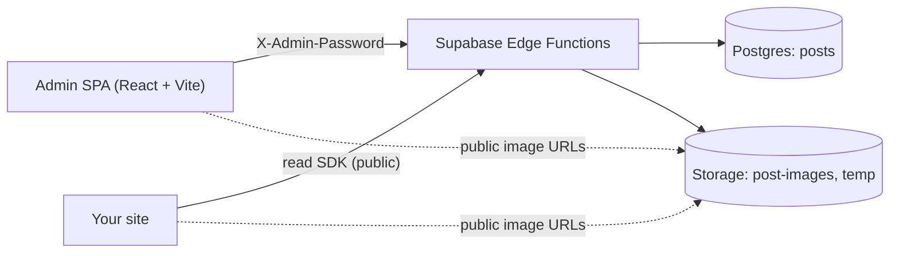

# MDPostComposer

English | [Português (Brasil)](LEIA-ME.md)

MDPostComposer is a pluggable Markdown post composer for Supabase-backed sites. It gives you a small HTTP API (Supabase Edge Functions on top of Postgres and Storage), a React admin panel to write and manage posts, and a read SDK plus a Markdown renderer you can drop into your own site to display them. You keep your own site, design and hosting; MDPostComposer only owns the content workflow.

- Write posts in Markdown with a live preview, a banner and inline images.
- Draft images in a temporary workspace, reference them by name (``), and let the server move them to the post's folder on save.
- Categories configured through environment variables, active/inactive posts (inactive posts are private), edit and delete existing posts.
- Admin UI in English and Brazilian Portuguese, no login service: a single admin password kept in memory only.
- Read SDK (`@mdpc/shared/client`) and a sanitized `MarkdownRenderer` (GFM + raw HTML) for any React site; or call the plain HTTP API from any language.
- The admin is a static SPA: build it once and host `admin/dist` anywhere.

## Architecture



- Writes (`create_post`, `update_post`, `delete_post`, `temp_images`) require the admin password.
- Reads (`load_cards`, `load_post`) are public for active posts; inactive posts need the password.
- Only the Edge Functions touch the database and the buckets (with the service role). Images are served straight from public Storage URLs.

### Repository layout

```
admin/       React 19 + Vite admin panel (static SPA)
shared/      @mdpc/shared: contracts, domain rules, read SDK, MarkdownRenderer (TypeScript sources, no build step)
supabase/    config.toml, SQL migration, Edge Functions (Deno) and their tests
scripts/     smoke test against a running stack
```

## Requirements

- Node.js 20+ and pnpm 9
- Docker (for the local Supabase stack)
- Deno 2 (optional: function tests and type-checks)
- A Supabase project (only for a remote deployment)

The Supabase CLI is installed as a dev dependency; run it with `pnpm supabase <command>`.

## Quick start (local)

```bash
pnpm install

# 1. Start the local Supabase stack (Postgres, Storage, API gateway) and apply the migration
pnpm supabase start
pnpm supabase db reset

# 2. Configure the functions and the admin
cp supabase/functions/.env.example supabase/functions/.env.local
cp admin/.env.example admin/.env.local
# PowerShell: Copy-Item supabase/functions/.env.example supabase/functions/.env.local
#             Copy-Item admin/.env.example admin/.env.local

# 3. Serve the Edge Functions (keep this running in its own terminal)
pnpm supabase functions serve --env-file supabase/functions/.env.local

# 4. Start the admin (another terminal)
pnpm dev
```

Edit `supabase/functions/.env.local`: set `MDPC_ADMIN_PASSWORD` to your own value and set `MDPC_PUBLIC_STORAGE_URL=http://127.0.0.1:54321/storage/v1/object/public` (otherwise the image URLs returned by the functions point to the Docker-internal host and do not load in the browser). Keep `http://localhost:5173` (the Vite dev server) in `MDPC_ALLOWED_ORIGINS`. The defaults in `admin/.env.example` already point to the local stack. If you change `MDPC_POST_CATEGORIES`, change `VITE_MDPC_POST_CATEGORIES` to the same list.

Open http://localhost:5173 and unlock the admin with the password. The browser never stores it: reloading the page asks for it again.

`supabase db reset` recreates the local database, including the two default buckets (`post-images`, `temp`). Stop the stack with `pnpm supabase stop` (add `--no-backup` to discard the data).

Check the whole API with the [smoke test](#smoke-test).

## Deploy (remote Supabase project)

```bash
pnpm supabase login
pnpm supabase link --project-ref <project-ref>
pnpm supabase db push

cp supabase/functions/.env.example supabase/functions/.env.production   # then edit it
pnpm supabase secrets set --env-file supabase/functions/.env.production
pnpm supabase functions deploy
```

- `SUPABASE_URL` and `SUPABASE_SERVICE_ROLE_KEY` are injected by Supabase; do not set them.
- Every function has `verify_jwt = false` in `supabase/config.toml`. This is intentional: callers are not Supabase users, and authorization is the `X-Admin-Password` header checked inside the functions (public read endpoints need no credential at all). Keep this setting; with `verify_jwt = true` browsers would need a Supabase JWT.
- Set `MDPC_ALLOWED_ORIGINS` to the exact origins of the admin site and of every browser-based site that reads posts (for example `https://admin.example.com,https://www.example.com`). Scheme, host and port must match.
- Build the admin with production values and host the output on any static host:

  ```bash
  # admin/.env.production
  # VITE_MDPC_FUNCTIONS_URL=https://<project-ref>.supabase.co/functions/v1
  # VITE_MDPC_STORAGE_PUBLIC_URL=https://<project-ref>.supabase.co/storage/v1/object/public
  pnpm build        # output: admin/dist
  ```

  The admin is built for the root path (`/`); serve it from the root of a (sub)domain. Values are baked in at build time, so changing them means rebuilding.
- Never commit `.env.local` / `.env.production` (they are gitignored).

## Configuration reference

### Edge Functions (`supabase/functions/.env.local`, or Supabase secrets)

| Variable | Required | Default | Description |
| --- | --- | --- | --- |
| `MDPC_ADMIN_PASSWORD` | yes | none | Admin password expected in the `X-Admin-Password` header. If it is missing every request fails with `500 SERVER_MISCONFIGURED`. |
| `MDPC_ALLOWED_ORIGINS` | recommended | empty | Comma-separated full origins (`https://admin.example.com`) allowed to call the functions from a browser. A request whose `Origin` is not listed gets `403 FORBIDDEN_ORIGIN`. Requests without an `Origin` header (servers, scripts, curl) are always accepted. An invalid entry is a configuration error. |
| `MDPC_PUBLIC_STORAGE_URL` | no | empty | Public base URL of Storage used in the URLs the functions return (`banner_url` in `load_cards` and `load_post`, `publicUrl` in `temp_images`). Leave empty on a hosted project. For local `supabase functions serve` set it to `http://127.0.0.1:54321/storage/v1/object/public`, because there `SUPABASE_URL` is the Docker-internal `http://kong:8000`, which browsers cannot reach. An invalid URL gives `500 SERVER_MISCONFIGURED`. |
| `MDPC_POST_CATEGORIES` | no | `BLOG` | Comma-separated categories; upper-cased; only `A-Z`, `0-9`, `_`, `-`. |
| `MDPC_POSTS_BUCKET` | no | `post-images` | Storage bucket for published post images. |
| `MDPC_TEMP_BUCKET` | no | `temp` | Storage bucket for the draft image workspace. |

`SUPABASE_URL` and `SUPABASE_SERVICE_ROLE_KEY` are injected by the Supabase runtime (local and hosted).

### Admin (`admin/.env.local`, read at build/dev time)

| Variable | Required | Default | Description |
| --- | --- | --- | --- |
| `VITE_MDPC_FUNCTIONS_URL` | yes | none | Base URL of the functions: `https://<ref>.supabase.co/functions/v1` (local: `http://127.0.0.1:54321/functions/v1`). |
| `VITE_MDPC_STORAGE_PUBLIC_URL` | yes | none | Public Storage base URL: `https://<ref>.supabase.co/storage/v1/object/public` (local: `http://127.0.0.1:54321/storage/v1/object/public`). |
| `VITE_MDPC_POSTS_BUCKET` | no | `post-images` | Must match `MDPC_POSTS_BUCKET`. |
| `VITE_MDPC_POST_CATEGORIES` | no | `BLOG` | Must match `MDPC_POST_CATEGORIES`. The first category is the default for new posts. |
| `VITE_MDPC_LOCALE` | no | `en` | UI language: `en` or `pt-BR`. |
| `VITE_MDPC_SITE_URL` | no | empty | Public website URL; the "open website" button is hidden when empty. |
| `VITE_MDPC_APP_TITLE` | no | `MD Post Composer` | Browser tab title. |

Rules:

- The category lists of the functions and of the admin must be identical; the functions are the source of truth and reject unknown categories with `400 INVALID_FORM_DATA`.
- The migration only creates the default buckets `post-images` and `temp` (public, 10 MB limit, png/jpeg/webp). If you use other names, create those buckets yourself (public, same limits) before using the app.

## Plugging into another project

### A. Read posts from your site (SDK + renderer)

`@mdpc/shared` ships TypeScript sources (no build step), so the consuming project needs a TypeScript-aware bundler such as Vite, Next.js or similar. Install it from the repository:

```bash
pnpm add "github:<owner>/MDPostComposer#path:/shared"
# or copy/vendor the shared/ folder (or use a git submodule) and depend on it:
#   "@mdpc/shared": "file:./vendor/mdpc-shared"
```

The Markdown renderer needs these peer dependencies in your project: `react`, `react-markdown`, `remark-gfm`, `rehype-raw`, `rehype-sanitize`. The client alone has no dependencies.

If you type-check with `tsc`, enable `"allowImportingTsExtensions": true` (with `"moduleResolution": "bundler"` and `"noEmit": true`), because the package exports point to `.ts` files.

```ts
import { createPostsClient } from "@mdpc/shared/client"

export const posts = createPostsClient({
  functionsUrl: "https://<ref>.supabase.co/functions/v1",
  storagePublicUrl: "https://<ref>.supabase.co/storage/v1/object/public",
  // postsBucket: "post-images",           // default
  // headers: { apikey: "<anon key>" },    // optional extra headers
})

// List active posts (cards). Optional client-side filter: { category: "BLOG" }
const list = await posts.listPosts({ category: "BLOG" })
if (list.ok) {
  for (const card of list.data) {
    console.log(card.title, card.slug, card.banner_url)
  }
}

// A page by slug (active posts only), or by id
const page = await posts.getPostBySlug("my-first-post")
if (!page.ok) {
  // { ok: false, status: 404, error: "POST_NOT_FOUND" }
}
```

Every call returns `{ ok: true, data } | { ok: false, status, error, details? }`. Network failures give `status: 0` and `error: "NETWORK_ERROR"`. `getPost(id, { adminPassword })` loads an inactive post (for previews), and `listPosts({ includeInactive: true, adminPassword })` lists all posts. Never ship the admin password in a public site.

Rendering (React):

```tsx
import { MarkdownRenderer } from "@mdpc/shared/react"
import { posts } from "./posts"

export function Post({ markdown }: { markdown: string }) {
  // The client resolves "<postId>/image1.jpg" to the public Storage URL
  return <MarkdownRenderer markdown={markdown} client={posts} className="prose" />
}
```

`MarkdownRenderer` accepts `markdown`, `className`, `resolveAssetUrl` (takes precedence), `client`, and `components` (overrides merged over the defaults). Raw HTML is allowed but sanitized.

`posts.buildPublicUrl(path)` and `posts.resolveMarkdownAssetUrl(url)` are available for custom rendering. The contract types (`PostCard`, `PostDetails`) are exported from `@mdpc/shared/client`.

### B. Call the HTTP API directly

Any language works. Reads need no credential:

```bash
curl "$FUNCTIONS_URL/load_cards"
curl "$FUNCTIONS_URL/load_post?id=<uuid>"
```

Writes need the `X-Admin-Password` header (see the API reference below). Calling from a server avoids CORS entirely; from a browser the page origin must be in `MDPC_ALLOWED_ORIGINS`.

## API reference

Base URL: `<functions-url>` (`https://<ref>.supabase.co/functions/v1` or `http://127.0.0.1:54321/functions/v1`).

Conventions:

- Admin auth: header `X-Admin-Password: <password>`. Missing header: `401 MISSING_PASSWORD`; wrong value: `401 WRONG_PASSWORD`.
- Success bodies are JSON with `"success": true`. Errors are `{ "error": "CODE", "details"?: {...} }`.
- An `Origin` header that is not in `MDPC_ALLOWED_ORIGINS` gives `403 FORBIDDEN_ORIGIN`. A wrong HTTP method gives `405 METHOD_NOT_ALLOWED`. Preflight `OPTIONS` is answered by every function.
- Images: `.png`, `.jpg`, `.jpeg`, `.webp` (MIME `image/png`, `image/jpeg`, `image/jpg`, `image/webp`), at most 10 MB each.

### Posts

| Method and path | Auth | Input | Success |
| --- | --- | --- | --- |
| `GET /load_cards` | none | `?include_inactive=true` (needs the password) | `200 { success, data: PostCard[] }`, newest first. Active posts only unless `include_inactive=true`. |
| `GET /load_post` | none for active posts; password for inactive | `?id=<uuid>` | `200 { success, data: PostDetails }` |
| `POST /create_post` | password | multipart form, see below | `200 { success: true, message: "POST_CREATED", id }` |
| `PUT /update_post` | password | multipart form, see below | `200 { success: true, message: "POST_UPDATED", id }` |
| `DELETE /delete_post` | password | JSON `{ "id": "<uuid>" }` | `200 { success: true, message: "POST_DELETED" }` |

`PostCard`: `id`, `title`, `slug`, `preview`, `post_type` (the category), `active`, `banner_url`.

`PostDetails`: `id`, `post_type`, `title`, `preview`, `active`, `slug`, `banner_path`, `banner_url`, `content_markdown`, `image_paths` (content images, banner excluded; each `<postId>/<file>`).

Form fields of `create_post` (all required unless noted) and `update_post`:

| Field | Type | Notes |
| --- | --- | --- |
| `id` | text | `update_post` only: the post to update. |
| `category` | text | One of `MDPC_POST_CATEGORIES` (case-insensitive). |
| `title` | text | Must produce a non-empty slug (otherwise `400 INVALID_TITLE`). Title and slug are unique. |
| `preview` | text | Short summary shown on cards. |
| `content_markdown` | text | Markdown body; `` refers to an uploaded image by file name without extension. |
| `active` | text | `true` or `false`. |
| `banner` | file | Required on create; optional on update (omit to keep the current one). |
| `images` | file, repeated | Content images. The file name without extension is the name used in the markdown. Duplicated names give `400 DUPLICATE_IMAGE_NAME`. |

`update_post` replaces all fields. The post's folder is reconciled with what you send: send the `images` for every content image the Markdown still uses (re-sent ones are overwritten at the same path, and an unreferenced `(name)` is not rewritten), because stored files that are not re-sent, and the old banner when a new one is uploaded, are removed after a successful update. The `?action=import` call of `temp_images` copies a published image back into the draft workspace for this purpose.

Error codes by endpoint (HTTP status in parentheses). Common to all: `FORBIDDEN_ORIGIN` (403), `METHOD_NOT_ALLOWED` (405), `SERVER_MISCONFIGURED` (500), `INTERNAL_ERROR` (500).

| Endpoint | Codes |
| --- | --- |
| `load_cards` | `MISSING_PASSWORD` (401), `WRONG_PASSWORD` (401) with `include_inactive=true` |
| `load_post` | `INVALID_ID` (400), `POST_NOT_FOUND` (404, also for an inactive post requested without the password header), `WRONG_PASSWORD` (401, inactive post with a wrong password) |
| `create_post` | `MISSING_PASSWORD`, `WRONG_PASSWORD` (401); `INVALID_FORM_DATA` (400); `INVALID_TITLE` (400); `TITLE_OR_SLUG_ALREADY_EXISTS` (409); `INVALID_EXTENSION`, `INVALID_IMAGE_TYPE`, `IMAGE_TOO_LARGE`, `DUPLICATE_IMAGE_NAME` (400); `UUID_COLLISION` (500); `TRANSIENT_ERROR_RETRY_FAILED` (503) |
| `update_post` | same as `create_post`, plus `POST_NOT_FOUND` (404) |
| `delete_post` | `MISSING_PASSWORD`, `WRONG_PASSWORD` (401); `INVALID_JSON` (400); `INVALID_ID` (400); `POST_NOT_FOUND` (404) |

`INVALID_IMAGE_TYPE` carries `details: { file, acceptedExtensions }`; `IMAGE_TOO_LARGE` carries `details: { file, maxMb }`.

Example:

```bash
curl -X POST "$FUNCTIONS_URL/create_post" \
  -H "X-Admin-Password: $MDPC_ADMIN_PASSWORD" \
  -F category=BLOG -F title="Hello" -F preview="First post" \
  -F active=true \
  -F 'content_markdown=# Hello

' \
  -F banner=@banner.jpg \
  -F images=@image1.jpg
```

### Draft images: `temp_images`

All methods require the password. The temp bucket is a single, global draft workspace shared by all callers.

| Method and request | Success |
| --- | --- |
| `GET /temp_images` | `200 { success, data: TempImage[] }` |
| `POST /temp_images` multipart: `file` (required), `name` (optional; defaults to the file name) | `200 { success, data: TempImage }` |
| `PATCH /temp_images` JSON `{ "path": "<path>", "name": "<new name>" }` | `200 { success, data: TempImage }` |
| `DELETE /temp_images` JSON `{ "path": "<path>" }` or `{ "all": true }` | `200 { success, data: { deleted: number } }` |
| `POST /temp_images?action=import` JSON `{ "postImagePath": "<postId>/<file>" }` | `200 { success, data: TempImage }` (copies a published image into the workspace so it can be edited and re-sent) |

`TempImage`: `name` (display name), `path` (object path in the temp bucket), `publicUrl` (with a `?v=` cache-buster). Names are normalized to lower-case letters, digits, `_` and `-`; stored paths look like `<name>__v__<token>.<ext>`.

Error codes: `INVALID_ACTION` (400, unknown `action` or `action` on a non-POST), `INVALID_FORM_DATA` (400), `INVALID_JSON` (400), `MISSING_FILE` (400), `INVALID_PATH` (400), `INVALID_NAME` (400), `INVALID_IMAGE_TYPE` / `IMAGE_TOO_LARGE` (400), `TEMP_IMAGE_NOT_FOUND` (404), `TEMP_IMAGE_ALREADY_EXISTS` (409), `POST_IMAGE_NOT_FOUND` (404), plus the auth errors above.

### How images work

1. While drafting, the admin uploads images to the **temp workspace** (`temp_images`). Each image has a name (for example `image1`).
2. The Markdown refers to the image by that name: ``.
3. On save, the admin sends the images with the form. The server stores them as `<postId>/<name>.<ext>` in the posts bucket and rewrites `(image1)` to `(<postId>/image1.jpg)` in the stored Markdown. The banner is stored as `<postId>/banner_<timestamp>.<ext>`.
4. When reading, the SDK / `MarkdownRenderer` resolves those relative paths to public Storage URLs (`<storagePublicUrl>/<bucket>/<postId>/image1.jpg`). Absolute URLs are left untouched.

## Security model and limitations

- **One shared admin password**, sent in the `X-Admin-Password` header and compared in constant time (SHA-256 digests). There are no user accounts, roles or sessions. There is **no rate limiting**: use a long random password, always use HTTPS, and consider putting a gateway or WAF in front of the functions if they are exposed to the internet.
- **CORS allow-list** (`MDPC_ALLOWED_ORIGINS`) protects browsers only. Non-browser clients send no `Origin` and are accepted; the password is the real protection.
- **Row Level Security** is enabled on `posts` with no policies and no grants for `anon`/`authenticated`: only the service role (the Edge Functions) reads or writes data. Use the functions, not PostgREST, to reach posts.
- **Public buckets**: published and draft images are readable by anyone who knows the URL. Do not upload anything secret, and remember inactive posts hide the post but not its image URLs.
- **Single global temp workspace**: one editor at a time. Two people drafting at once share (and can delete) each other's draft images.
- No versioning/history, no scheduling, no soft delete: deleting a post removes its row and its files.
- Sanitized Markdown: raw HTML is parsed and sanitized by `MarkdownRenderer`; if you render the Markdown with another library, sanitize it yourself.

## Development

```bash
pnpm dev                   # admin dev server
pnpm build                 # type-check and build the admin (admin/dist)
pnpm lint                  # ESLint (admin)
pnpm test                  # Vitest (shared, admin) + deno test (functions)
pnpm test:functions        # only the Edge Function tests (needs Deno)
pnpm -C shared test        # only the shared tests
pnpm -C shared typecheck   # tsc for shared
```

Type-check the Edge Functions with Deno (from the repository root):

```bash
deno check --config supabase/functions/load_post/deno.json supabase/functions/load_post/index.ts
```

### Smoke test

With the stack running (see Quick start), run the end-to-end flow (create, list, load, update, visibility, duplicate title, wrong password, temp images, delete). It needs Node 20+ and no dependencies, and always tries to delete the data it creates:

```bash
MDPC_FUNCTIONS_URL=http://127.0.0.1:54321/functions/v1 \
MDPC_ADMIN_PASSWORD=<your password> \
node scripts/smoke/smoke.mjs
```

(PowerShell: `$env:MDPC_FUNCTIONS_URL="..."; $env:MDPC_ADMIN_PASSWORD="..."; node scripts/smoke/smoke.mjs`.) Optional: `MDPC_SMOKE_CATEGORY` (default `BLOG`; must be one of your categories) and `MDPC_POSTS_BUCKET` (default `post-images`). It prints PASS/FAIL per step and exits non-zero on failure. It also works against a remote project, but it creates and deletes a real post there.

### Commit convention

[Conventional Commits](https://www.conventionalcommits.org/): `type(scope): subject`, in English, imperative and lower-case, for example `fix(functions): hide inactive posts from public load_post`.

## License

[MIT](LICENSE)
